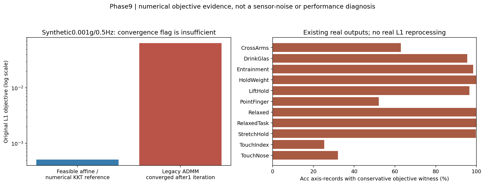

# Phase9最终报告：包含L1数值证据的发布前修订

**Level0/1已完成；训练0、normalization重拟合0、真实L1重处理0，Level2未执行。** 此版本取代audit/pre_solver_witness_snapshot内发布前草稿。原Phase3–8、数据、正式模型和原阈值均未改变。

## 首要发现

1. **FACT/EVIDENCE：L1数值精度和批次独立性存在实证问题。** 原始/处理文件创建hash匹配8580条；25,740条Acc轴中20173条具有保守目标次优见证，涉及7490腕记录。见证考虑float32舍入和未知前48点，并不把它们当坏信号。相同合成输入单独与合批trend最大差0.0081994g。原实际275批在split前混合，train成员97.10%–100%共享non-train停止准则。不能继续声称全链预处理严格逐受试者独立；这不是已证实标签泄漏，也没有证明BA被提高多少。
2. **FACT：结构完整，局部timestamp问题存在。** 390人×11活动×双腕8580记录，空文件/缺活动/缺腕/NaN/Inf/exactduplicate均0，4条大间隙max0.646577s。Gyro与raw[48:]float32全量精确一致。
3. **EVIDENCE/UNKNOWN：设备和物理输入契约需澄清。** Series3 PD93/DD11、Series4 PD183/DD103；原始Acc单位g明确，但是否已分离gravity/导出前变换UNKNOWN，不能加假定1g或按性能选坐标轴。
4. **NO_ACTION：不扩大裁剪，不重复添加已有抗混叠。** 官方启动振动已有48点近似裁剪；无依据再删1–5s。当前HarNet FIR抗混叠存在，零延拓边界效应另有信号证据，但不优先于solver问题，也没有分类改进证据。
5. **FACT：split/norm/padding局部检查通过，但不能抵消上游耦合。** 45norm成员及tensor一致、零refit；15集合内部互斥；STRfull976/2000且真长度切片，HarNet覆盖post48；每人4个val appearance仍只有1人。

## 当前数据流

完整源码/函数/形状/单位/fit/label/split表见DATA_PIPELINE_MAP.md及data_pipeline_steps.csv。Raw解析→原全batch近似L1(Acc)/Gyro原样→trim48→float32/full length→subject split→train-only norm→mask/true-length STR；parallel rawAcc→clip/context→30Hzpolyphase→FrozenHarNet→bilateral/activity/subject+STR。关键修订是L1目标数学可分、实现停止却非逐记录独立。

## 数值证据与解释

[L1_SOLVER_CORRECTNESS_REPORT.md](L1_SOLVER_CORRECTNESS_REPORT.md)提供公式、合成数值KKT证书、原输出下界/参考上界、原solver日志和批次来源。原“合成频率响应”必须解释成legacy有限迭代实现响应，不能当精确L1理论响应；原cohort原始质量/边界统计不变，132/440/880固定族不缩小、不重选。37/132质量关联与9/440边界class关联仍为探索性，不能说是病理机制或故障标签。历史outer接触、原全cache访问及多轮development偏差永久保留。

## 十八项最终判断

| question | evidence_status | judgment |
| --- | --- | --- |
| 1 原始质量是否有明确问题？ | FACT/EVIDENCE | 结构完整且4时间间隙；另有确认的L1目标次优/批次耦合，不等同传感器噪声。 |
| 2 前几秒是否设备噪声？ | FACT/UNKNOWN | 官方启动振动约0.5s有依据，当前已裁48点；不能把所有前几秒活动认作噪声，也不能逐人分离振动和动作。 |
| 3 是否11活动一致？ | EVIDENCE | 任务长度/时域/边界分布不同，无跨11活动支持统一再裁1–5s的证据。 |
| 4 PD/DD启动特征不同？ | EVIDENCE/UNKNOWN | 固定BH440中启动项0显著、结束项9显著；不构成启动等价性证据，设备混杂/个体差异限制解释。 |
| 5 应删0.5/1/2/3/5s？ | NO_ACTION | 维持当前48点；无证据额外删除1–5s。48与精确0.5s也不自动重新调整。 |
| 6 采样/重采样合理？ | FACT/QUALIFIED | STR标称100Hz索引，HarNet100→30匹配预训练；实测时基约99.2–100.8Hz且4间隙使均匀轴只是近似。 |
| 7 抗混叠不足？ | FACT/NO_ACTION | 当前polyphase FIR存在，未发现缺失抗混叠；边界零延拓是不同问题。 |
| 8 滤波丢震颤信息？ | EVIDENCE/LIMITATION | 原经验响应混入数值精度与合批停止，不能解释为精确L1的理论保留率；临床震颤信息UNKNOWN。 |
| 9 双腕同步？ | UNKNOWN | 相对offset可量化，缺共同绝对时钟/触发校准，不能声称物理完全同步，不DTW。 |
| 10 坐标系一致？ | UNKNOWN/NO_ACTION | 通道命名顺序一致不代表物理朝向一致，没有安装/轴标定不翻转。 |
| 11 固定长度截断？ | FACT | STR无额外固定crop，976/2000完整；HarNet完全覆盖post48，暂无尾部截断。 |
| 12 padding/mask正确？ | FACT | 先真实norm后containerpad，encoder前切长度，合成bitwise不变测试通过。 |
| 13 normalization丢疾病信息？ | FACT/UNKNOWN | train-only共享affine不按人消幅；未见epsilon问题。下游特征利用和跨活动尺度影响未知，不能从元数据证明全部信息保留。 |
| 14 统计泄漏？ | FACT/LIMITATION | ID与norm成员正确，但L1 split前全批停止有确认的无监督数值耦合，不能声称全链严格subject-independent；标签泄漏/性能虚高未被证明。 |
| 15 哪些保留？ | NO_ACTION | 保留原48裁剪、Gyro语义、11活动、完整变长、真长度/mask、train-onlynorm、HarNet现有抗混叠、subject级划分与原0.5规则。 |
| 16 哪些独立对照？ | HYPOTHESIS_READY_FOR_REVIEW | 优先单因素L1逐记录数值精度/证书修复；line边界后续单独审阅，不能组合。 |
| 17 哪些可能改善模型？ | HYPOTHESIS | 数值修复有确定正确性依据，实际BA/DD改善未知；先澄清设备与Acc输入契约。 |
| 18 哪些不值得继续？ | NO_ACTION | 无差别裁1–5s、重复添加已有抗混叠、仅求平滑、未知轴翻转/DTW、subject归一化、按MAD删患者及11活动标签驱动滤波搜索。 |

## 候选与停止

| priority | candidate | status | expected_gain | future_cost | stop |
| --- | --- | --- | --- | --- | --- |
| 0 | ACC-INPUT-SEMANTICS | AUDIT_REQUIRED_BEFORE_LEVEL2 | resolve input interpretation; performance improvement UNKNOWN | 0 new model training for provenance; future experiments not approved | STOP_INPUT_SEMANTICS_UNKNOWN; no guessed axes or1g offsets |
| 0 | DEVICE-CONFOUND-AUDIT | AUDIT_PRIORITY_NOT_PREPROCESSING_CHANGE | clarify reliability of preprocessing inference, not claimed model improvement | 0 newtraining for metadata/locked cached prediction reporting; not executed | unverifiable device logs or inadequate precision;no causal claim |
| 1 | PREP-L1-PRECISION | REVIEW_ELIGIBLE_NUMERICAL_CORRECTNESS | restore numerical consistency and independence; BA/DD gain UNKNOWN | solver QA+bounded CPU benchmark first; only after approval and all certificates: train-only norm15 splits +45 matchedclassifier-side runs; HarNet cache unchanged | any certificate failure;batch-dependence remains;CPU budget exceeded;provenance failure;no automatic model promotion without joint gate |
| 2 | PREP-RESAMPLE-BOUNDARY | DEFER_AFTER_SOLVER_AND_INPUT_CONTRACT | reduce numerically induced edge transient; classification gain UNKNOWN | one candidate: external frozen feature export +45classifier-side runs, original max50/patience12 | STOP if Acc/HarNet input semantics unresolved;baseline replay fail;no localized real effect;provenance fail; joint gate fail |
| 2 | PREP-TIMESTAMP | DEFERRED_CLOCK_SEMANTICS | UNKNOWN, affects few records; no automatic correction | not budgeted or executed; needs revised concrete protocol first | no reliable clock evidence or signal distortion |
| 9 | PREP-ACTIVITY-SPECIFIC | NO_ACTION_NO_CAUSAL_QC_RULE | unsupported | 0 | no protocol-backedinvalidinterval |
| 9 | PREP-ANTIALIAS | NO_ACTION_PRESENT | unsupported | 0 | no attenuation/alias defect evidence |
| 9 | PREP-FILTER | NO_ACTION_FOR_NEW_FILTER_SEPARATE_SOLVER_PRECISION | HYPOTHESIS only;no clinical signalgroundtruth | 0 now;not runnablecandidate | cannot distinguish gravity from usefulslowmotion |
| 9 | PREP-LENGTH-PADDING | NO_ACTION_CURRENT_CORRECT | unsupported | 0 | noactualtruncation |
| 9 | PREP-NORM | NO_ACTION_CURRENT_TRAIN_ONLY | unsupported | 0 | no concrete evidence of scalingerror |
| 9 | PREP-START | NO_ACTION_KEEP_CURRENT48 | unproven | 0 | no invalid-interval/repeatability evidence |
| 9 | PREP-SYNC-AXIS | NO_ACTION_UNKNOWN_PHYSICAL_MAPPING | unsupported | 0 | no physicalgroundtruth |

优先可审阅的具体改动是固定lambda50目标的数值精度/逐记录独立性修复，不是新滤波强度搜索。需要独立源码、逐series dual-gap证书、顺序/批次不变性、CPU上限，再经用户明确批准才能真实重处理、train-only norm和45配对run。性能收益UNKNOWN；正确性与模型提升分别判定，不能强行保留模型。Line边界仅作为后续单因素，不与L1组合。

16必需报告、Acc语义补充、L1正确性报告、全部CSV均已生成。逐人表/异常位置/44原始代表图仅私有；公开为聚合/合成，稀有交叉格数值抑制。24,180旧资产保护hash最终复核；旧Phase9发布前snapshot保留，旧冻结声明按其命名空间验证，原正式历史不覆盖。完整未来规范见LEVEL2_EXPERIMENT_PROTOCOL.md。**在Level0/1停止，未经用户批准不启动Level2。**
