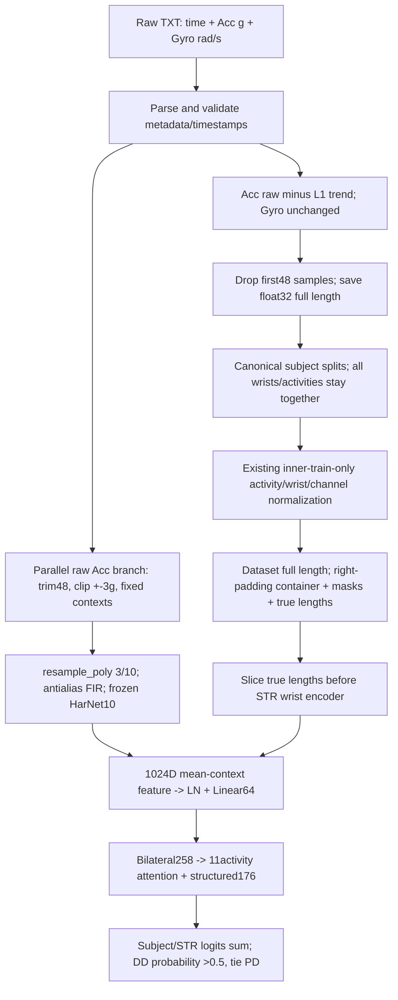

# 当前真实数据链路

| step | source_relative_to_deep_final_or_mainline | function | input_shape | output_shape | input_unit | output_unit | sampling_rate | label_use | requires_fit | fit_subject_ID_scope | split_order | leakage_or_limitation |
| --- | --- | --- | --- | --- | --- | --- | --- | --- | --- | --- | --- | --- |
| Cohort definition | src/datasets/prepare_pads.py | condition_to_label | patient metadata | 390 PD/DD people | diagnosis | PD/DD label | not applicable | YES: task definition | NO population fit | none | before split | label-based target definition, not feature fit |
| TXT parsing | foundation_validation/scripts/prepare_multi_activity_data_v2.py | _load_raw_signal | [T,7] | time[T], sensor[6,T] | s; g; rad/s | same | nominal100; measured per record | NO | NO | none | before split | record-local; no cross-subject statistics |
| Timestamp/pair validation | src/datasets/prepare_pads.py | _signal_quality; _build_pair | two time axes | monotonic/fs/offset metadata | seconds | seconds | median fs checked within nominal tolerance | NO | NO | none | before split | no timestamp correction; absolute synchronization unproven |
| Calibration and axes | prepare_pads.py / preprocessing.py | metadata order; direct array copy | 6 axes | same native device axes | g;rad/s | same | unchanged | NO | NO calibration | none | before split | axis equivalence UNKNOWN; no unit conversion/flip |
| Acc detrend / Gyro | src/datasets/preprocessing.py | l1_trend_filter_batch | [6,T] | [6,T] | g;rad/s | Acc residual g; Gyro rad/s | index-based nominal100 | NO | per-record trend optimization; no cohort fit | current record only; ID private | before split | offline noncausal adaptive operation; no LTI cutoff |
| Initial trim / persistence | prepare_multi_activity_data_v2.py | prepare_v2; _save_array | [6,1024 or2048] | [6,976 or2000] float32 | same | same | no resampling | NO | NO | none | before split | 48 samples, not exact wall-clock0.5s; time removed from tensor |
| Manifest and subject split | src/datasets/nested_cv.py; folds.py | subject_metadata_from_records; build_subject_fold_datasets | 4290 pairs /390 people | 15 train-query-excluded ID sets | IDs/strata | same | not applicable | YES: stratification | split fixed historically | IDs private; counts in overlap CSV | subject split before normalization | all activities/wrists/windows inherit patient role |
| Normalization | src/datasets/builders.py; folds.py | _activity_statistics; build_subject_fold_datasets | inner-train full signals | mean/std[11,2,6,1] | g;rad/s | Z units | full samples, no padding | NO labels for numeric mean/std | HISTORICAL train-only fit; Phase9 zero refits | matching inner-train IDs only; private lineage | after subject split | metadata matches45 checkpoints; no validation norm fit found |
| Dataset and collate | src/datasets/subject_activity.py | _normalize; __getitem__; collate_subject_activities | one patient11 bilateral records | [B,11,2,6,Tmax]+mask+lengths | Z units | same | nominal100 | label carried, not used in transform | NO new fit | existing checkpoint norm | after split | normalize real samples then right-pad; full-length mode |
| STR wrist path | src/models/pure_deep.py | _encode_activities_with_wrists; PureDeepWristEncoder.forward | valid wrist[6,trueT] | 64D/wrist | Z units | learned representation | learned Conv stride; not sensor resampling | historical CE training only | historically train-only; not run here | matching inner-train | after split | no current FFT bandpass/MIL crop; config legacy bands not executed |
| HarNet raw context path | artifacts/phase3b_external_ssl_20260928/scripts/extract_ssl.py | raw context loop | raw Acc[3,T] after48 | one or two [3,1000] contexts | g | g clipped+-3 | nominal100 | NO | NO PADS fit | each record; frozen external encoder | historically pre-split label-independent export | raw branch bypasses L1 and STR Z-score; clips are adapter limits not sensor fullscale |
| HarNet resampling | extract_ssl.py; scipy.signal | resample_poly(3,10) | [1000,3] | [3,300] | g | g | 100->30 nominal; Kaiser5 FIR | NO | NO | none | historically before split | anti-alias exists; default zero extension creates window-edge transient |
| Frozen feature cache / residual | src/models/wssl.py | FrozenEmbeddingCache; SSLLoader; ResidualSSLSubject | [N,11,2,1024] | residual64 /bilateral258 | encoder representation | learned representation | context features, not sample-time sequence | exportNO; projection historicalYES | HarNet fixed; projection train-only | current inner-train for projection | cache pre-split; supervised model after split | global cache decoded wholesale in original entry: access-boundary weakness, not automatically label leakage |
| Decision and selection | src/models/pure_deep.py; engine/runner.py; nested_training.py | forward; evaluate_epoch; _run_inner_fold | subject258 + structured176 | two logits/probabilities | features | PD/DD probability | not applicable | historical CE fit/train and BA validation selection | original model train-only; no Phase9 fit | inner-train; validation only epoch selection | after split | repeated validation selection bias; no new outer assessment |

当前源码以mainline、foundation_validation准备脚本及Phase3B提取脚本为准，audit/source_inventory.csv给出hash和AST函数索引。没有执行生产准备或训练入口。旧配置frequency/MIL字段、旧MFAM文档的FFT描述不代表当前PureDeepSubject实际forward；当前spectral.enabled=false。官方预处理会把长活动先切成两个1024点片段再分别去趋势/裁48，且去掉3活动；本项目保留11项，长活动整段去趋势后只裁一次48，形成2000点。它是已冻结的项目v2协议，不能称与官方预处理逐位或形状完全一致。

---
数据来源：服务器PADS v1.0.0的390人PD/DD任务子集，原始数据、既有v2信号及45 Frozen WSSL-STR checkpoint元数据；不是原库全部469人。统计单位为患者，同患者双腕先平均；原始记录/通道数只作描述性计数，不作为独立患者。15重叠development splits、seeds42/43/44用于来源核查，不是独立外部验证。缺失/不可计算值为NA，不补造；频谱超过记录Nyquist不外推；稀有交叉分层<10人的数值统计抑制，完整表仅私有。检验族132/440/880分别BH，患者bootstrap2000次；其余描述性表无额外显著性声明。接触全390人诊断标签及validation成员元数据用于质量关联，未读分类错误名单/分数，未构建outer loader、未解码outer性能/预测；历史outer接触永久披露。全队列探索会增加未来选择偏差，不能叫盲态独立验证。训练/分类器拟合/normalization重拟合均0，Level2未执行。
