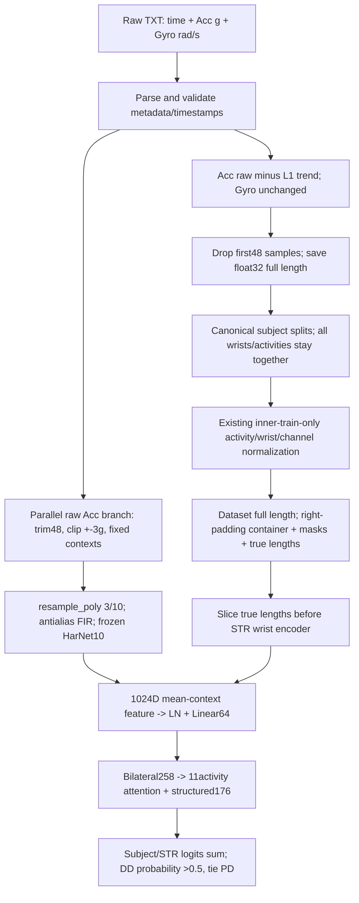
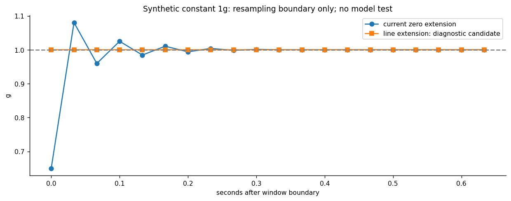
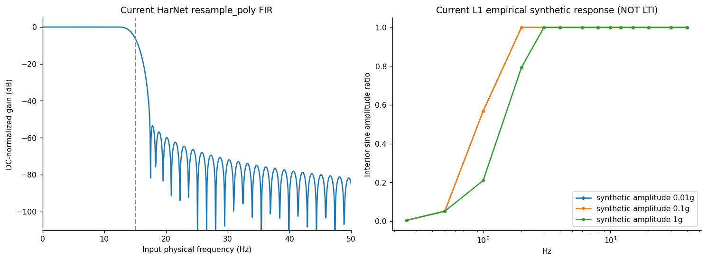

# Phase9 Raw IMU与预处理审计：Level0/1完成

**没有训练、没有normalization重拟合、没有改变任何正式输入或模型，Level2未执行。** 全部计算在服务器，正式起点4745549，目录pads_raw_preprocessing_audit_20261112。

最关键结论：当前不是“原始数据有大量缺失”或“没有抗混叠”。结构检查通过；原始Acc重力语义仍未核实；4条时间戳间隙值得保留警示；官方启动振动已由48点近似裁剪处理；设备metadata存在Series3/4与PD/DD混杂；HarNet零延拓重采样有可重复的窗口边界数值效应，是本轮唯一具体可供审阅的预处理单因素。它尚无模型性能提升证据。

## 真实流程

全部步骤的源码、函数、形状、单位、rate、label/fit/IDs/split顺序及泄漏限制见DATA_PIPELINE_MAP.md和analysis/data_pipeline_steps.csv。

## 已确认、潜在与应保留

FACT：390人11活动双腕8580记录完整，NaN/Inf/空文件/exactduplicate/非递增时间戳均0；原始gyro与处理后raw[48:]float32全量精确相等。median-fs99.2065–100.8077Hz；4条大间隙max0.646577s。45norm的fit成员与checkpoint值一致，最小std0.0117629，无新refit；15split内部无ID交叉，每人4个validation appearance仍是同一人。STR无额外截断、padding未进入腕encoder；HarNet覆盖全部post48信号。

EVIDENCE：Series3 PD93/DD11、Series4 PD183/DD103，提示设备混杂；质量class主族37/132项BH<.05，不能区分病理运动与采集因素。边界class族9/440项BH<.05均为结束项，无启动显著项不等于可删除启动信息。L1合成响应保留3–12Hz稳态但衰减低频，不足以证明真实病理信息无损。

HYPOTHESIS：line边界延拓可能减少由零延拓引入的端点transient；UNKNOWN是能否改善BA/DDRecall及是否适配原HarNet预训练分布。UNKNOWN首先包括PADS导出Acc/HarNet预训练输入的重力语义，还包括共同绝对clock、左右设备物理轴、硬件满量程和可靠静止噪声参考。NO_ACTION：不扩展启动裁剪、不自动滤波/插值/时移/翻转、不删异常候选/患者、不改norm或split。

## 十八项判断

| question | evidence_status | judgment |
| --- | --- | --- |
| 1 原始质量是否有明确问题？ | FACT/EVIDENCE | 结构完整、finite且无exactduplicate；4条大时间戳间隙是真实观测，packet-loss机制UNKNOWN；高幅/jerk flag不是已确认坏信号。 |
| 2 前几秒是否设备噪声？ | FACT/UNKNOWN | 官方启动振动约0.5s有依据，当前已裁48点；不能把所有前几秒活动认作噪声，也不能逐人分离振动和动作。 |
| 3 是否11活动一致？ | EVIDENCE | 任务长度/时域/边界分布不同，无跨11活动支持统一再裁1–5s的证据。 |
| 4 PD/DD启动特征不同？ | EVIDENCE/UNKNOWN | 固定BH440中启动项0显著、结束项9显著；不构成启动等价性证据，设备混杂/个体差异限制解释。 |
| 5 应删0.5/1/2/3/5s？ | NO_ACTION | 维持当前48点；无证据额外删除1–5s。48与精确0.5s也不自动重新调整。 |
| 6 采样/重采样合理？ | FACT/QUALIFIED | STR标称100Hz索引，HarNet100→30匹配预训练；实测时基约99.2–100.8Hz且4间隙使均匀轴只是近似。 |
| 7 抗混叠不足？ | FACT/NO_ACTION | 当前polyphase FIR存在，未发现缺失抗混叠；边界零延拓是不同问题。 |
| 8 滤波丢震颤信息？ | EVIDENCE/HYPOTHESIS | 合成3–12Hz稳态保留、低频衰减且幅值依赖；真实临床震颤信息保留率UNKNOWN，不能把PSD能量差直接说成疾病信息丢失。 |
| 9 双腕同步？ | UNKNOWN | 相对offset可量化，缺共同绝对时钟/触发校准，不能声称物理完全同步，不DTW。 |
| 10 坐标系一致？ | UNKNOWN/NO_ACTION | 通道命名顺序一致不代表物理朝向一致，没有安装/轴标定不翻转。 |
| 11 固定长度截断？ | FACT | STR无额外固定crop，976/2000完整；HarNet完全覆盖post48，暂无尾部截断。 |
| 12 padding/mask正确？ | FACT | 先真实norm后containerpad，encoder前切长度，合成bitwise不变测试通过。 |
| 13 normalization丢疾病信息？ | FACT/UNKNOWN | train-only共享affine不按人消幅；未见epsilon问题。下游特征利用和跨活动尺度影响未知，不能从元数据证明全部信息保留。 |
| 14 统计泄漏？ | FACT/LIMITATION | 未发现现有norm成员/subject集合泄漏；重复validation选择、全缓存访问边界和历史outer接触仍在。全390标签质量探索也增加未来选择偏差。 |
| 15 哪些保留？ | NO_ACTION | 保留原48裁剪、Gyro语义、11活动、完整变长、真长度/mask、train-onlynorm、HarNet现有抗混叠、subject级划分与原0.5规则。 |
| 16 哪些独立对照？ | HYPOTHESIS_READY_FOR_REVIEW | 只把HarNetpadtype=line列具体可审阅单因素；设备混杂先审计；timestamp候选须先补clock证据。 |
| 17 哪些可能改善模型？ | HYPOTHESIS | 数值边界修复可能减少伪transient，但实际BA/DD收益完全未测，不承诺。设备可靠性澄清可能比再滤波更有价值。 |
| 18 哪些不值得继续？ | NO_ACTION | 无差别裁1–5s、重复添加已有抗混叠、仅求平滑、未知轴翻转/DTW、subject归一化、按MAD删患者及11活动标签驱动滤波搜索。 |

## 候选与停止条件

| priority | candidate | status | expected_gain | future_cost | stop |
| --- | --- | --- | --- | --- | --- |
| 0 | ACC-INPUT-SEMANTICS | AUDIT_REQUIRED_BEFORE_LEVEL2 | resolve input interpretation; performance improvement UNKNOWN | 0 new model training for provenance; future experiments not approved | STOP_INPUT_SEMANTICS_UNKNOWN; no guessed axes or1g offsets |
| 1 | PREP-RESAMPLE-BOUNDARY | REVIEW_ONLY_INPUT_CONTRACT_PREREQUISITE | reduce numerically induced edge transient; classification gain UNKNOWN | one candidate: external frozen feature export +45classifier-side runs, original max50/patience12 | STOP if Acc/HarNet input semantics unresolved;baseline replay fail;no localized real effect;provenance fail; joint gate fail |
| 0 | DEVICE-CONFOUND-AUDIT | AUDIT_PRIORITY_NOT_PREPROCESSING_CHANGE | clarify reliability of preprocessing inference, not claimed model improvement | 0 newtraining for metadata/locked cached prediction reporting; not executed | unverifiable device logs or inadequate precision;no causal claim |
| 2 | PREP-TIMESTAMP | DEFERRED_CLOCK_SEMANTICS | UNKNOWN, affects few records; no automatic correction | not budgeted or executed; needs revised concrete protocol first | no reliable clock evidence or signal distortion |
| 9 | PREP-START | NO_ACTION_KEEP_CURRENT48 | unproven | 0 | no invalid-interval/repeatability evidence |
| 9 | PREP-ANTIALIAS | NO_ACTION_PRESENT | unsupported | 0 | no attenuation/alias defect evidence |
| 9 | PREP-FILTER | NO_ACTION_FOR_NEW_FILTER_DEFER_LOW_FREQ_HYPOTHESIS | HYPOTHESIS only;no clinical signalgroundtruth | 0 now;not runnablecandidate | cannot distinguish gravity from usefulslowmotion |
| 9 | PREP-SYNC-AXIS | NO_ACTION_UNKNOWN_PHYSICAL_MAPPING | unsupported | 0 | no physicalgroundtruth |
| 9 | PREP-LENGTH-PADDING | NO_ACTION_CURRENT_CORRECT | unsupported | 0 | noactualtruncation |
| 9 | PREP-NORM | NO_ACTION_CURRENT_TRAIN_ONLY | unsupported | 0 | no concrete evidence of scalingerror |
| 9 | PREP-ACTIVITY-SPECIFIC | NO_ACTION_NO_CAUSAL_QC_RULE | unsupported | 0 | no protocol-backedinvalidinterval |

每项的证据、具体单因素、分布风险、correctness和损失见PREPROCESSING_CANDIDATES.md。LEVEL2_EXPERIMENT_PROTOCOL.md已准备唯一line候选的45run上限、原recipe/seed/split/0.5规则、固定BH族和联合门槛，**只有用户审查明确批准且物理输入契约核实后才能运行**，本轮不作任何自动延续。设备混杂不通过删人/改label解决，时间戳修复尚未到可执行门槛。

## 产物与隐私

16项报告、全部规定CSV、44固定代表私有图与13公开群体/合成图均生成；逐文件/逐人/异常位置表位于restricted_manifests，公开analysis为匿名聚合。少于10人的交叉细胞数值抑制。工程schema和smoke语法修正、warning均保留，不重写失败历史。保护24180既有文件最终hash复核见phase9_integrity.json，发布后另有tree/remote读回回执。历史outer接触与多轮development偏差永久保留，不能因本次审计PASS宣称临床独立验证或全项目从未接触outer。

---
数据来源：服务器PADS v1.0.0的390人PD/DD任务子集，原始数据、既有v2信号及45 Frozen WSSL-STR checkpoint元数据；不是原库全部469人。统计单位为患者，同患者双腕先平均；原始记录/通道数只作描述性计数，不作为独立患者。15重叠development splits、seeds42/43/44用于来源核查，不是独立外部验证。缺失/不可计算值为NA，不补造；频谱超过记录Nyquist不外推；稀有交叉分层<10人的数值统计抑制，完整表仅私有。检验族132/440/880分别BH，患者bootstrap2000次；其余描述性表无额外显著性声明。接触全390人诊断标签及validation成员元数据用于质量关联，未读分类错误名单/分数，未构建outer loader、未解码outer性能/预测；历史outer接触永久披露。全队列探索会增加未来选择偏差，不能叫盲态独立验证。训练/分类器拟合/normalization重拟合均0，Level2未执行。

补充物理输入门槛：见[Acc语义说明](ACCELERATION_SEMANTICS_ADDENDUM.md)。Line候选可审阅但不能在输入契约UNKNOWN时直接进入训练。
