# 实际HarNet10结构审计

| stage | input_channels | input_length | output_channels | output_length | parameters | conv_layers | residual_blocks | BN_layers |
| --- | --- | --- | --- | --- | --- | --- | --- | --- |
| layer1 | 3 | 300 | 64 | 150 | 83520 | 5 | 2 | 5 |
| layer2 | 64 | 150 | 128 | 75 | 369920 | 5 | 2 | 5 |
| layer3 | 128 | 75 | 256 | 15 | 1477120 | 5 | 2 | 5 |
| layer4 | 256 | 15 | 512 | 3 | 5903360 | 5 | 2 | 5 |
| layer5 | 512 | 3 | 1024 | 1 | 2623488 | 1 | 0 | 1 |

```mermaid
flowchart LR
    raw["Raw Acc 3×300 at30Hz"] --> layer1
    layer1["layer1: 3×300 → 64×150 / Conv 5, ResBlock 2, BN 5"]
    layer2["layer2: 64×150 → 128×75 / Conv 5, ResBlock 2, BN 5"]
    layer3["layer3: 128×75 → 256×15 / Conv 5, ResBlock 2, BN 5"]
    layer4["layer4: 256×15 → 512×3 / Conv 5, ResBlock 2, BN 5"]
    layer5["layer5: 512×3 → 1024×1 / Conv 1, ResBlock 0, BN 1"]
    layer1 --> layer2 --> layer3 --> layer4 --> layer5 --> pooled["1024D → wrist residual → original WSSL"]
```

每个stage由Conv、0或2个pre-activation ResBlock、BN/ReLU及anti-aliased downsampling构成。ResBlock为BN→ReLU→Conv→BN→ReLU→Conv加identity残差。最后stage不是ResBlock。官方预训练完整feature extractor10,457,408参数，逐state与原官方checkpoint比对。FT-L1解冻layer5卷积，FT-L2解冻layer4/5卷积；所有BN affine及running buffers固定。

历史Phase3C仅layer5 LR2e-5且BN affine可训练；本轮LR1e-5并冻结affine，另有Certified数据/norm与fresh下游状态差异，不是网络结构创新。HarNet原始Raw Acc路径不改变。
