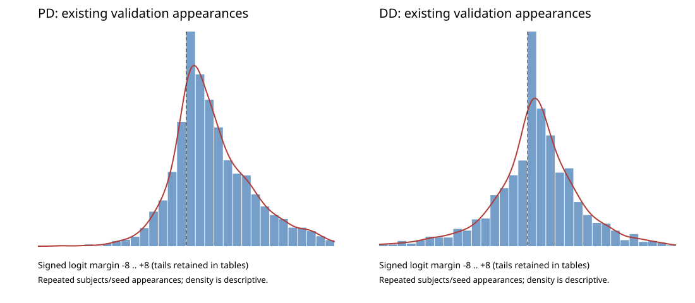

# Certified WSSL margin诊断

定义s=zDD−zPD，m=(2y−1)s；pDD>.5、tiePD。高置信错误p_true<.1；边界.45≤pDD≤.55。

| label_name | count | mean | median | std |
| --- | --- | --- | --- | --- |
| DD | 1368 | 0.459259 | 0.439651 | 2.29225 |
| PD | 3312 | 1.41052 | 1.01509 | 2.15702 |

完整分位数/IQR、正确/错误与seed稳定性见margin_metrics和margin_seed_stability；图密度为重复appearance描述，不作独立样本推断。

固定15个重叠development splits；同人重复出现。三seed不是独立患者队列。人口记录和逐人预测不公开，正式阈值/模型指针不改。历史outer文字接触和多轮development选择偏差保留；本轮未读取outer性能。
