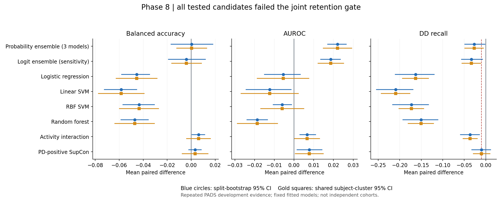

# Phase8 Frozen WSSL-STR Guided Discriminative Optimization

A1→A2→B→C→D依次完成。全部计算在服务器，实际2026-11-12；按请求保留目录20261111。正式起点35b0a7cb78b28f29385724cf98f4f1dbdde8b2b2。原Frozen WSSL-STR、阈值0.5、预处理、normalization和历史checkpoint均保持。

- probability_ensemble: **REJECT**；未通过：BA_wins_at_least10, BA_CI_low_positive, DD_recall_drop_at_most01, stability_at_most1_25
- logistic_regression: **REJECT**；未通过：BA_positive, BA_wins_at_least10, BA_CI_low_positive, AUROC_non_decrease, MacroF1_non_decrease, DD_recall_drop_at_most01, stability_at_most1_25
- linear_svm: **REJECT**；未通过：BA_positive, BA_wins_at_least10, BA_CI_low_positive, AUROC_non_decrease, MacroF1_non_decrease, DD_recall_drop_at_most01, stability_at_most1_25
- rbf_svm: **REJECT**；未通过：BA_positive, BA_wins_at_least10, BA_CI_low_positive, AUROC_non_decrease, MacroF1_non_decrease, DD_recall_drop_at_most01, stability_at_most1_25
- random_forest: **REJECT**；未通过：BA_positive, BA_wins_at_least10, BA_CI_low_positive, AUROC_non_decrease, MacroF1_non_decrease, DD_recall_drop_at_most01, stability_at_most1_25
- xgboost: **NOT_RUN_DEPENDENCY_MISSING**
- activity_interaction: **REJECT**；未通过：DD_recall_drop_at_most01
- subject_supcon: **REJECT**；未通过：BA_CI_low_positive
- logit_ensemble: **REJECT**；未通过：BA_positive, BA_wins_at_least10, BA_CI_low_positive, DD_recall_drop_at_most01, stability_at_most1_25

## 统一结果

下表先split内平均三seed指标，再15split等权；ensemble每split一个系统直接与seed-first baseline配对。概率集成主候选，logit仅敏感性；XGB未运行。完整实验状态表analysis/final_experiment_state.csv包含每候选目的、假设、方法、参数、训练成本、六分类/九指标、p/q/CI、seedSD和状态。

| condition | status | accuracy | ba | auroc | macro_f1 | pd_recall | dd_recall | nll | brier | ece |
| --- | --- | --- | --- | --- | --- | --- | --- | --- | --- | --- |
| activity_interaction | REJECT | 0.769251 | 0.725805 | 0.766245 | 0.722707 | 0.830861 | 0.620749 | 0.669741 | 0.372104 | 0.124756 |
| baseline | OFFICIAL_RETAINED_SINGLE_MODEL | 0.745604 | 0.719644 | 0.759553 | 0.706589 | 0.782344 | 0.656945 | 0.616720 | 0.386441 | 0.110333 |
| linear_svm | REJECT | 0.750068 | 0.661396 | 0.747254 | 0.669397 | 0.874960 | 0.447832 | 0.739386 | 0.388745 | 0.152168 |
| logistic_regression | REJECT | 0.749238 | 0.674347 | 0.754078 | 0.679919 | 0.854757 | 0.493936 | 1.084555 | 0.423008 | 0.195916 |
| logit_ensemble | REJECT | 0.754069 | 0.715740 | 0.778185 | 0.709980 | 0.808170 | 0.623310 | 0.544251 | 0.350267 | 0.084375 |
| probability_ensemble | REJECT | 0.757318 | 0.720025 | 0.781620 | 0.714136 | 0.809996 | 0.630053 | 0.529978 | 0.346340 | 0.073229 |
| random_forest | REJECT | 0.741508 | 0.672599 | 0.740908 | 0.675718 | 0.838714 | 0.506485 | inf | 0.368994 | 0.100759 |
| rbf_svm | REJECT | 0.755990 | 0.676242 | 0.753525 | 0.684421 | 0.868275 | 0.484208 | 0.728147 | 0.382762 | 0.150615 |
| subject_supcon | REJECT | 0.754394 | 0.722915 | 0.767261 | 0.713233 | 0.798717 | 0.647114 | 0.592164 | 0.370729 | 0.101779 |
| xgboost | NOT_RUN_DEPENDENCY_MISSING | NA | NA | NA | NA | NA | NA | NA | NA | NA |

## 科学问题的回答

1. 三seed概率互补改善AUROC和概率质量，但BA仅+0.000380，8/15wins、CI跨0，DD recall −0.026892；未通过门槛。该集成历史Phase3B已出现，本轮是复核，不是新发现。固定ensemble无法估计seed方差，不报告虚假零方差。

2. 本轮四种固定读出均未联合优于原head；没有证据将传统分类器作为正式baseline。这不能证明原仿射读出达到数学线性上限，也不能否定其他预先独立验证的正则化/核。RBF相对Linear直接差异另列readout_RBF_minus_Linear.csv，不把相对较好等同优于原模型。树模型未带来DD收益，不能据分数变化认定其学到活动因果交互。RF至少一个unit真类概率为0，proper NLL为+inf；相关均值/区间/检验不能视作有限改善，原值保留，推断NA并占据原BH族。

3. 真实forward确有pooling前token mixing的结构缺口；B填补该缺口后BA+0.006161、AUROC+0.006691，split BA区间为正，但DD recall−0.036196超过0.01限制，因此REJECT。增加跨活动表达能力能够改变决策，不能据此认定其改善本任务联合目标。attention不是临床重要性。

4. C只检验CE+.1、tau.1、PD不同患者positive、DDnegative的单一asymmetric SupCon；不是传统双类SupCon的完整家族检验。BA+0.003271、10/15wins，95%splitCI[-0.002036,+0.008490]，AUROC+0.007708，DD recall−0.009831。C状态为**REJECT**；BA证据未过门槛，不能以单seed最好结果选模型。HarNet固定、原分类侧从原seed初始化，recipe不变。

5. DD异质性没有被人为作为单一positive簇。geometry表比较两模型各自空间内cosine分布、norm和正确类logit margin，train/validation分开；不作未对齐坐标直接差。Other/ET/Atypical/MS只是粗来源类，不是可靠临床亚型。下表>25%压缩计数是45模型上的预定描述警示；依赖pair不是独立患者，也不是亚型结构已损坏或临床可解释的证明。

| split | comparison | baseline_mean | SupCon_mean | mean_ratio | model_pairs_compressed_over25pct |
| --- | --- | --- | --- | --- | --- |
| train | DD_within | 0.282349 | 0.235561 | 0.959123 | 12 |
| train | PD_DD_between | 0.498609 | 0.397259 | 1.094654 | 21 |
| train | PD_within | 0.258748 | 0.151198 | 0.717490 | 33 |
| validation | DD_within | 0.342717 | 0.253264 | 0.937542 | 25 |
| validation | PD_DD_between | 0.363752 | 0.259653 | 0.913476 | 27 |
| validation | PD_within | 0.302198 | 0.197819 | 0.850582 | 28 |

6. 最值得继续的是独立cohort与重复测量可靠性验证；本轮没有足够证据优先扩大传统读出、B或C配置搜索。原正式single-model继续保留；没有为提高BA而改阈值、挑seed、追加门控/解冻/频域/patch或重开历史负配置。候选后续方向的假设、证据、区别、成本和停止条件见NEXT_STAGE_RESEARCH_PLAN.md，本轮不执行。

7. **没有新模型通过联合保留门槛**，包括C；正式最佳仍为原Frozen WSSL-STR。全部证据来自同390患者重复开发。15重叠split不是15独立队列；split bootstrap、Wilcoxon/BH和subject-cluster均不能消除多轮验证选择偏差或历史outer接触。不得声称临床外部泛化或疾病机制因果证明。

## 核心配对证据

| condition | metric | mean_delta | wins | ci_low | ci_high | wilcoxon_p | global_primary_BH16_q | global_secondary_BH56_q |
| --- | --- | --- | --- | --- | --- | --- | --- | --- |
| probability_ensemble | ba | 0.000380 | 8.000000 | -0.016742 | 0.018008 | 0.846924 | 0.967913 | NA |
| probability_ensemble | auroc | 0.022067 | 15.000000 | 0.017059 | 0.026521 | 0.000061 | 0.000163 | NA |
| probability_ensemble | pd_recall | 0.027652 | 12.000000 | 0.006968 | 0.049225 | 0.024810 | NA | 0.044817 |
| probability_ensemble | dd_recall | -0.026892 | 4.000000 | -0.048837 | -0.002017 | 0.044396 | NA | 0.077693 |
| logistic_regression | ba | -0.045297 | 0.000000 | -0.057889 | -0.034540 | 0.000061 | 0.000163 | NA |
| logistic_regression | auroc | -0.005475 | 6.000000 | -0.014974 | 0.003150 | 0.330261 | 0.406475 | NA |
| logistic_regression | pd_recall | 0.072414 | 14.000000 | 0.041540 | 0.107117 | 0.000122 | NA | 0.000684 |
| logistic_regression | dd_recall | -0.163008 | 0.000000 | -0.210557 | -0.119998 | 0.000061 | NA | 0.000488 |
| linear_svm | ba | -0.058249 | 0.000000 | -0.072308 | -0.045310 | 0.000061 | 0.000163 | NA |
| linear_svm | auroc | -0.012299 | 5.000000 | -0.024271 | -0.001480 | 0.096197 | 0.139923 | NA |
| linear_svm | pd_recall | 0.092616 | 15.000000 | 0.061010 | 0.129851 | 0.000653 | NA | 0.002152 |
| linear_svm | dd_recall | -0.209113 | 0.000000 | -0.254156 | -0.168912 | 0.000653 | NA | 0.002152 |
| rbf_svm | ba | -0.043403 | 0.000000 | -0.056857 | -0.030671 | 0.000061 | 0.000163 | NA |
| rbf_svm | auroc | -0.006028 | 5.000000 | -0.010517 | -0.001195 | 0.035339 | 0.062826 | NA |
| rbf_svm | pd_recall | 0.085931 | 15.000000 | 0.057904 | 0.118207 | 0.000061 | NA | 0.000488 |
| rbf_svm | dd_recall | -0.172737 | 0.000000 | -0.216464 | -0.132975 | 0.000061 | NA | 0.000488 |
| random_forest | ba | -0.047045 | 0.000000 | -0.058578 | -0.035788 | 0.000061 | 0.000163 | NA |
| random_forest | auroc | -0.018645 | 0.000000 | -0.023847 | -0.013442 | 0.000061 | 0.000163 | NA |
| random_forest | pd_recall | 0.056370 | 12.000000 | 0.028701 | 0.086163 | 0.004272 | NA | 0.009969 |
| random_forest | dd_recall | -0.150460 | 0.000000 | -0.192277 | -0.111338 | 0.000653 | NA | 0.002152 |
| xgboost | ba | NA | NA | NA | NA | NA | NA | NA |
| xgboost | auroc | NA | NA | NA | NA | NA | NA | NA |
| xgboost | pd_recall | NA | NA | NA | NA | NA | NA | NA |
| xgboost | dd_recall | NA | NA | NA | NA | NA | NA | NA |
| activity_interaction | ba | 0.006161 | 11.000000 | 0.000668 | 0.011347 | 0.072998 | 0.116797 | NA |
| activity_interaction | auroc | 0.006691 | 12.000000 | 0.002925 | 0.010981 | 0.008362 | 0.019113 | NA |
| activity_interaction | pd_recall | 0.048517 | 13.000000 | 0.031457 | 0.065392 | 0.001613 | NA | 0.004518 |
| activity_interaction | dd_recall | -0.036196 | 4.000000 | -0.058973 | -0.014365 | 0.017036 | NA | 0.034073 |
| subject_supcon | ba | 0.003271 | 10.000000 | -0.002036 | 0.008490 | 0.220899 | 0.294532 | NA |
| subject_supcon | auroc | 0.007708 | 12.000000 | 0.001484 | 0.014181 | 0.030151 | 0.060303 | NA |
| subject_supcon | pd_recall | 0.016373 | 10.000000 | -0.005973 | 0.039936 | 0.232851 | NA | 0.362213 |
| subject_supcon | dd_recall | -0.009831 | 5.000000 | -0.032470 | 0.011542 | 0.529651 | NA | 0.674101 |
| logit_ensemble | ba | -0.003905 | 7.000000 | -0.019006 | 0.011877 | 0.719727 | NA | NA |
| logit_ensemble | auroc | 0.018632 | 15.000000 | 0.013558 | 0.023491 | 0.000061 | NA | NA |
| logit_ensemble | pd_recall | 0.025826 | 12.000000 | 0.005529 | 0.046757 | 0.030874 | NA | NA |
| logit_ensemble | dd_recall | -0.033635 | 4.000000 | -0.056231 | -0.007646 | 0.024780 | NA | NA |

完整九指标、cluster CI、参数与时间见analysis和COST_AND_DEPLOYMENT.md；NA项目保留在固定族。进入Phase9之前停止。

## DD几何解释

验证DD类内cosine距离的逐模型比率平均为0.937542，45模型中25个超过预设25%压缩警示；粗来源类间可计算条目270个，其中154个超过警示。该统计是模型×来源类对的依赖描述，不能作为独立临床亚型破坏率；其结构是否受到临床意义的破坏仍无法验证。norm/margin和每类Recall必须一起看，详见supcon_class_margin.csv及九指标。
