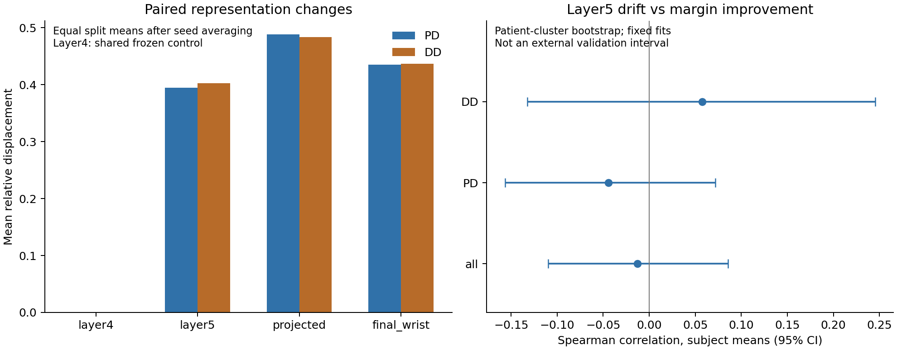

# Phase 6A: paired representation audit

All45 pairs passed the asset gate before inference. Fresh inference recovered both archived validation prediction tables with maximum absolute probability error 1.1102230246251565e-16 (fixed tolerance1e-12), all decisions unchanged. 90 validation evaluations, 89.659460s; no training or new fitting. This fills the previous missing paired-feature evidence. It does not establish disease-specific mechanisms.

## Inputs and extraction

Checkpoint, provenance, canonical split, labels, per-split normalization and raw/processed input hashes were checked, rather than inferring pairs from filenames. Activities follow the canonical11-name order, wrists left/right, local branch AccXYZ/GyroXYZ at nominal100Hz. External HarNet uses Acc only: trim48, clip±3g, short edge pad to1000, otherwise first/last1000 windows, resample3/10 to3×300. Local preprocessing and train-only normalization use the protected mainline implementation.

Legacy full-cohort feature/sensor NPZ arrays were never decoded. Raw signals were opened only after per-target validation ID allowlisting. To reproduce original CUDA numerical shapes, metadata fixes64-window batch positions and final-batch shape; other slots contain synthetic zeros, with no excluded subject signal or label. Eval mode prevents cross-row BN updates. Each raw-subject external export is first created only while that person is a legal query; later models fetch only their own query IDs.

Layer4 window maps and means (512), layer5 means (1024), projected residual and final wrist (64 each) preserve subject×11activities×2wrists, window counts and lengths. Final wrist equals local plus projected residual under the explicit saved architecture. Layer1–4 are the same fixed official encoder in both models; layer4 is deliberately a shared zero-drift control. Adapted layer5 is loaded into a plain explicit official layer5 module; no closure/deepcopy substitution. Projected/final changes include independently learned projection/local/head parameters and cannot be attributed solely to HarNet last-block changes.

## Drift magnitude

Metrics are computed per valid activity/wrist vector and averaged equally across the22 vectors to obtain one patient scalar. Means below average seeds within each split, then15 splits equally; std columns in the CSV are split SD, not independent-patient uncertainty.

| layer | cosine_distance_mean | L2_mean | relative_displacement_mean | frozen_norm_mean | adapted_norm_mean |
| --- | --- | --- | --- | --- | --- |
| final_wrist | 0.094818 | 3.230706 | 0.435633 | 7.514325 | 7.802477 |
| layer4 | 0.000000 | 0.000000 | 0.000000 | 6.138752 | 6.138752 |
| layer5 | 0.085248 | 3.552761 | 0.396967 | 9.883820 | 7.942572 |
| projected | 0.107460 | 2.591077 | 0.486695 | 5.356625 | 5.725006 |

Dcos=1−cos, L2=Euclidean displacement, Drel=L2/(Frozen norm+1e-12). Zero norms are explicitly handled in code. Raw L2 must not rank changes across different dimensionalities/scales. Layer4 zero is a design check. Layer5 changes are measurable and include norm contraction; neither cosine nor Drel identifies disease information.

## Relationship with prediction change

Primary margin is true-label signed log-odds `(2y−1)*(zDD−zPD)`; change is adapted minus frozen. Predictions, probabilities, margins, flips and correct→wrong/wrong→correct events are matched by subject/split/seed. Do not confuse these appearance-level events with Phase5's patient grouping, which averages3 seed probabilities per appearance and correctness over4 appearances.

Primary3 tests: within each seed/split, Spearman(Drel layer5, signed log-odds margin change), then mean over all3 seeds and all15 units. Split-bootstrap intervals and Wilcoxon/BH are descriptive for correlated development splits.

| test | mean_delta | ci_low | ci_high | wilcoxon_p | bh_q_planned_family_sensitivity |
| --- | --- | --- | --- | --- | --- |
| layer5/DD/margin_change | 0.039317 | -0.044668 | 0.122806 | 0.389404 | 0.389404 |
| layer5/PD/margin_change | 0.030796 | -0.027332 | 0.088088 | 0.276855 | 0.389404 |
| layer5/all/margin_change | 0.021579 | -0.005612 | 0.048844 | 0.187622 | 0.389404 |

No primary association is supported. Subject-cluster sensitivity changes the estimand to Spearman of each subject's12-appearance scalar means, conditional on fixed fits:

| label | subject_count | spearman | ci_low | ci_high |
| --- | --- | --- | --- | --- |
| all | 390 | -0.012639 | -0.109757 | 0.085344 |
| PD | 276 | -0.044265 | -0.156687 | 0.071670 |
| DD | 114 | 0.057629 | -0.132581 | 0.245301 |

The old43 improved/46 worsened/301 unchanged patient grouping was exactly recovered. Improved minus worsened mean layer5 Drel is−0.000088, patient-cluster95%CI[−0.017923,0.017407]. Corresponding projected and final-wrist intervals also cross0. Appearance-group split tests are NA at14/15 complete units; no unit was silently dropped.

DD−PD layer5 Drel averages+0.008108 across15 units,15/15positive, splitCI[0.005299,0.011131], conservative planned-family BH6 q=0.000366. The patient-mean class contrast is+0.008386, clusterCI[−0.001045,0.017585], a different estimand. DD Frozen norms are lower (9.688120 vs PD9.964711), so a denominator contribution cannot be excluded. A disease-specific adaptation mechanism is not established.

Exploratory projected/final-wrist drift–margin correlations are positive for PD (0.159208/0.137567), and weaker/negative for DD. These are exploratory associations, not a direct between-class interaction test or causal localization. The patient-cluster projected PD correlation is0.112451[0.001800,0.223609], whereas the overall interval crosses0. Final-wrist flip correlation is0.105816[0.009043,0.201151] at patient-mean level; a flip can harm or help. These unadjusted exploratory cluster intervals cannot override the primary null.

## Seed versus split stability

`representation_seed_split_stability.csv` separates mean within-split seed SD, between-split SD and SD of3 seed means. Layer5 overall Drel=.396967, mean within-split seedSD=.071072, splitSD=.043329. Magnitudes vary even though patient rankings recur.

An additional post-result descriptive audit computes within-split matched-patient Drel rank correlations between seed pairs42/43,42/44,43/44 (no new hypothesis tests or selection):

| layer | label | mean | std | min | max |
| --- | --- | --- | --- | --- | --- |
| final_wrist | all | 0.349275 | 0.126089 | 0.133503 | 0.545224 |
| layer4 | all | NA | NA | NA | NA |
| layer5 | all | 0.982454 | 0.008911 | 0.970365 | 0.995812 |
| projected | all | 0.417576 | 0.163091 | 0.035403 | 0.667614 |

Layer5 rank correlation averages.982454 (range.970365–.995812), projected.417576, final-wrist.349275. Rank repeatability does not prove stable benefit, anatomical relevance, external transport or absolute magnitude agreement. Layer4 rank is NA because all displacements are0.

## Limits and provenance

Historical outer performance exposure and past whole-table/whole-array reading deviations remain permanently disclosed. This round does not restore an untouched outer test. No new outer performance was read, no outer loader was built, and no outer signal was supplied to a target model. Subjects rotate roles across development splits: the union of legitimate validation queries spans 390 people, but every model is restricted to its own validation allowlist. Full metadata rows are parsed for filtering and window-position/length metadata is used for historical numerical batch layout; hashing reads file bytes. These are application-level controls, not OS-enforced physical isolation. The 15 splits share patients and are repeated development evidence, never 15 independent cohorts.

Features, IDs, raw lineage and per-patient drift/predictions remain server-private. All495 exported feature NPZs have content hashes linked to checkpoint, source, preprocessing, normalization, split/seed/context and fit/query/excluded IDs. No gate was trained from improved patients. See statistical appendix for undefined tests and the explicitly post-result conservative BH sensitivity.
