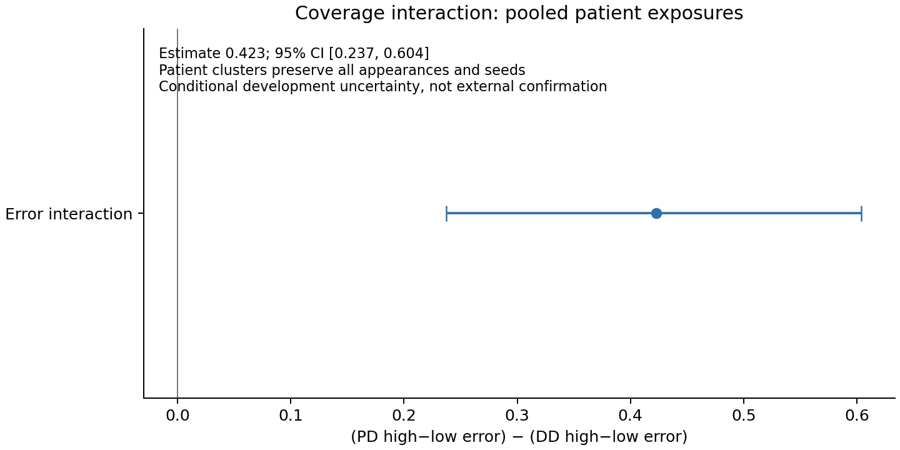

# Phase 6B: class-conditional coverage reliability

The direct disease-class×high-reference-distance error interaction is directionally stable in these development records. Its clinical cause is unresolved. High distance is not a clinical anomaly label or a safe universal rejection rule.

## Frozen score definitions

Only Phase5 stored legal query scores are used: u=min(dPD,dDD), existing relative score, and saved split q25/q75 low/high groups. Stored values and group labels were checked unchanged. Neither reference bank, scaler, PCA nor cutoff was fitted/recomputed. All three seeds remain present. Values below are equal split/seed means, not pooled patient estimates.

| label | coverage_group | error_rate | correct_rate | absolute_margin | true_signed_margin | relative_score |
| --- | --- | --- | --- | --- | --- | --- |
| DD | high | 0.229848 | 0.770152 | 0.286522 | 0.170010 | 0.030590 |
| DD | low | 0.519021 | 0.480979 | 0.270016 | -0.051968 | -0.003798 |
| PD | high | 0.300587 | 0.699413 | 0.272040 | 0.137085 | 0.003355 |
| PD | low | 0.150468 | 0.849532 | 0.294063 | 0.237937 | -0.028282 |

Coverage margin is the original probability margin: abs(pDD−.5), and (2y−1)*(pDD−.5) for true signed margin. This differs from Phase6A log-odds margin and must not be mixed numerically.

## Direct interaction

Error interaction=(PD high−low error)−(DD high−low error). Margin interactions use DD minus PD, as fixed in the protocol. The estimand first averages3 seed contrasts within a split, then15 splits. No claim is based on comparing two separate class p-values.

| test | mean_delta | ci_low | ci_high | wins | wilcoxon_p | bh_q |
| --- | --- | --- | --- | --- | --- | --- |
| error_interaction_PD_minus_DD | 0.439291 | 0.326885 | 0.557102 | 15 | 0.000061 | 0.000183 |
| true_margin_interaction_DD_minus_PD | 0.322831 | 0.242876 | 0.401089 | 14 | 0.000122 | 0.000183 |
| absolute_margin_interaction_DD_minus_PD | 0.038530 | 0.011554 | 0.063949 | 13 | 0.018066 | 0.018066 |

Error interaction=.439291 (43.9291 percentage points),15/15positive, BH3q=.000183. Split intervals do not make overlapping splits independent.

Patient-cluster bootstrap resamples390 subjects stratified by class, retaining all4 appearances×3seeds per sampled patient; its estimand is pooled exposure high−low contrasts, conditional on fixed fits/cutoffs:

| metric | direction | interaction | PD_high_minus_low | DD_high_minus_low | ci_low | ci_high |
| --- | --- | --- | --- | --- | --- | --- |
| error | PD_minus_DD | 0.422650 | 0.148441 | -0.274209 | 0.237459 | 0.603781 |
| true_signed_margin | DD_minus_PD | 0.311407 | -0.098519 | 0.212888 | 0.180807 | 0.436084 |
| absolute_margin | DD_minus_PD | 0.029411 | -0.019158 | 0.010254 | -0.016458 | 0.073399 |

Pooled error interaction=.422650,95%CI[.237459,.603781]; this corroborates direction while estimating a different weighting from.439291. No retraining/bootstrap refit uncertainty or new-hospital uncertainty is included. Absolute-margin clusterCI crosses0 despite its split result; do not promote it as robust confidence separation.

## Confounders and unresolved explanations

All11 activities and both wrists are present and finite for these390 validation patients, with lengths/window counts retained. Thus binary availability and nominal activity composition do not vary here; they cannot identify effects of completion quality, movement severity, duration differences, timing or device quality. An observed complete task is not proof of identical clinical performance.

All5 context-mean error interactions are positive (.467370,.417666,.542186,.365891,.403344); these use development context labels, not outer performance. Reference banks are balanced PD/DD within split (59–62/class); the within-split class contrast cannot be explained solely by unequal class bank count. Geometry, nearest-neighbor coverage, subtype heterogeneity and fit-sample quality remain unresolved. Bank count varies with context/fit composition and cannot be causally isolated across15 overlapping units.

Every person has4 validation appearances×3seeds, and patient-cluster weighting preserves those repetitions. DD subtype information does not support an individual query-subtype interaction: the public source describes heterogeneous DD, but no new clinical subtype linkage was created. Phase5 did not save per-activity/wrist reference distances, so task/wrist decomposition is BLOCKED_NOT_SAVED. No new scoring, bank or PCA fit was performed to fill that gap.

A plausible interpretation is that this pooled reference-distance geometry has class-dependent meaning: proximity may align differently with PD-like or heterogeneous DD features. This is a hypothesis, not a verified clinical explanation. Correlated training composition, subject difficulty and denominator/aggregation choices could also contribute. An independent compatible PD/DD cohort and pre-specified subgroup metadata are needed to distinguish explanations.

Historical outer performance exposure and past whole-table/whole-array reading deviations remain permanently disclosed. This round does not restore an untouched outer test. No new outer performance was read, no outer loader was built, and no outer signal was supplied to a target model. Subjects rotate roles across development splits: the union of legitimate validation queries spans 390 people, but every model is restricted to its own validation allowlist. Full metadata rows are parsed for filtering and window-position/length metadata is used for historical numerical batch layout; hashing reads file bytes. These are application-level controls, not OS-enforced physical isolation. The 15 splits share patients and are repeated development evidence, never 15 independent cohorts.

No anomaly gate, reject option, threshold search or reference fusion was created. Phase5 fusion remains REJECT, strict WSSL-error relative ranking .416706 remains weak, and overall reference net rescue remains negative.
