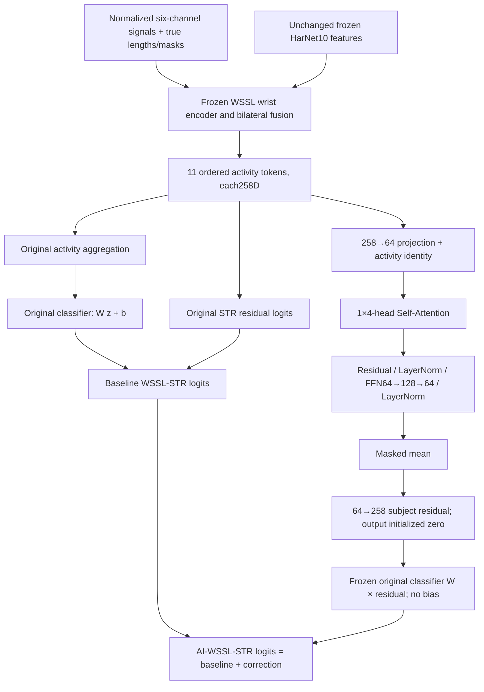

# AI-WSSL-STR — Activity Interaction WSSL-STR

**Lifecycle status: Experimental Candidate.** This independent model registration does not promote the model, change `conclusions/CURRENT_MODEL.json`, or authorize more training. Frozen WSSL-STR remains the Retained Model; STR-01 remains its Matched Baseline.

## Model identity and implementation

| Field | Value |
|---|---|
| Canonical ID | `ai_wssl_str` |
| Display name | `AI-WSSL-STR` |
| Architecture version | `phase8_activity_interaction_v1` |
| Registry | `mainline/models/registry.json` |
| Independent architecture | `mainline/src/models/ai_wssl_str.py` |
| Independent configurations | `mainline/configs/ai_wssl_str_seed42.yaml`, seed43, seed44 |
| Training entry | `mainline/scripts/train_ai_wssl_str.py` |
| Named load/inference entry | `mainline/scripts/model_cli.py --model AI-WSSL-STR` |
| Checkpoint catalog | `mainline/models/ai_wssl_str_checkpoints.json` |

The `_ActivityInteractionCore` class is the existing Phase8 `ActivityInteraction` class copied verbatim except for its class name. Registration tests compare its complete AST against the historical implementation. The registered wrapper adds shape/provenance checks and an explicit frozen signal→token interface. It introduces no new network layers or parameters. Original `pure_deep.py`, `wssl.py`, `src/models/__init__.py`, STR configs, historical entry points and old checkpoints remain unchanged.

The model starts from Frozen WSSL-STR bilateral activity tokens `[B,11,258]`. The added module applies a258→64 projection,11 activity identity embeddings, one4-head self-attention block, residual connections with two LayerNorms, FFN64→128→64, dropout0.1 and masked mean pooling. A zero-initialized64→258 output produces a subject residual. The **existing frozen classifier weight**, with `bias=None`, maps that residual to a logit correction:

`AI logits = original WSSL subject logits + original STR logits + interaction residual logits`.

The original classifier bias appears once in the subject path. The added correction shares its weight; no separate classifier, gate, extra STR contribution or SupCon is introduced. All original WSSL parameters and buffers remain frozen, and its modules remain in eval even when the AI module trains. HarNet10 remains frozen.



| Parameter scope | Count |
|---|---:|
| Original frozen classifier side | 143,172 |
| Added interaction module / trainable | 67,522 |
| Combined classifier side | 210,694 |
| Frozen external HarNet10 | 10,457,408 |
| Unique complete deployment total | 10,668,102 |

## Calling, loading and inference

Run from `/home/zyt/deep_final/mainline` using the existing analysis environment. The unified registry is additive: the historical low-level `src.models.build_model` and old development entry remain unchanged for reproducibility.

```python
from src.models.registry import build_registered_model, list_models
from src.models.registered_checkpoint import load_registered_checkpoint

model = build_registered_model("AI-WSSL-STR", seed=42)
model, provenance = load_registered_checkpoint(
    "AI-WSSL-STR",
    checkpoint_id="AI-WSSL-STR:certified-l1:seed42:context0:inner0",
    device="cuda",
)
# Existing supervised bilateral tokens and their explicit activity mask:
result = model.forward_tokens(bilateral_tokens, activity_mask)

# Or already-normalized six-axis input plus matching frozen HarNet features:
result = model(signals, wrist_mask, activity_mask, activity_lengths,
               ssl_features=frozen_harnet_features)
```

The full signal interface uses the unchanged WSSL encoder at the supplied true lengths and computes the original readout once. It does not run L1, fit normalization, parse raw sensor files or extract HarNet. Callers supply the checkpoint's matching preprocessing/normalization. The CLI checks token data version, activity order, base checkpoint and normalization SHA. Legacy L1 and Certified L1 checkpoints have distinct IDs and data provenance; they are not silently substituted.

```bash
cd /home/zyt/deep_final/mainline
PY=/home/zyt/envs/mfam_analysis/bin/python
"$PY" -B scripts/model_cli.py --list
"$PY" -B scripts/model_cli.py --model AI-WSSL-STR --list-checkpoints
"$PY" -B scripts/model_cli.py --model AI-WSSL-STR \
  --checkpoint-id AI-WSSL-STR:certified-l1:seed42:context0:inner0 --device cuda
```

Inference adds `--input`, `--output`, and optionally `--limit`. Outputs must be new private paths; no file is overwritten. The checkpoint includes `base.*` and all original interaction keys and strict-loads without changing any historical `.pt` bytes. Newly saved registered files also carry explicit model ID, architecture version, lifecycle status and config metadata. Registration round-trip files are test copies with zero optimizer updates, not new trained models.

## Training entry and fixed recipe

The dedicated trainer consumes explicit hash-verified train/validation token packages and a matching frozen WSSL checkpoint. `--validate-only` checks these bindings without constructing an optimizer or training. Actual training requires a separate explicit experimental authorization; registration did not invoke it.

```bash
"$PY" -B scripts/train_ai_wssl_str.py --help
# Validation only; BASE and BASE_SHA come from the corresponding catalog record.
"$PY" -B scripts/train_ai_wssl_str.py \
  --config configs/ai_wssl_str_seed42.yaml \
  --token-index /home/zyt/deep_final/artifacts/activity_interaction_certified_pilot3_20261112/restricted_manifests/manifests/token_index.json \
  --base-checkpoint "$BASE" --base-sha256 "$BASE_SHA" \
  --context 0 --inner 0 --validate-only
```

Recipe remains Phase8B: batch8, token DataLoader workers0, original seed/shuffle rules, AdamW2e−4/weight decay1e−4/betas(.9,.999), train-balanced CE with zero label smoothing, cosine50/min1e−6, clip5, max50/patience12, strict validation BA selection, AMPfalse. Only67,522 added parameters enter the optimizer. No structure, loss or hyperparameter changes are made. New checkpoint filenames identify model/seed/context/inner/best epoch and never replace old files.

## Evidence and checkpoint provenance

The catalog contains **48 existing checkpoints**, with stable IDs such as:

- `AI-WSSL-STR:legacy-l1:seed42:context0:inner0` — one of45 historical old-L1 development checkpoints.
- `AI-WSSL-STR:certified-l1:seed42:context0:inner0` — one of3 Certified pilot checkpoints.

Each entry records the exact checkpoint SHA, base WSSL SHA, normalization SHA, seed/split, data version, training source SHA, source commit and report. Registered loading rejects wrong model, SHA, seed, provenance or state layout. Checkpoint weights and individual predictions stay on the server; the catalog itself contains no patient identities.

### Historical old-L1 Phase8

[Phase8 Activity Interaction report](../../../artifacts/wssl_guided_optimization_phase8_20261111/reports/ACTIVITY_INTERACTION_REPORT.md), source commit `4745549dabf34ccc89a740ad361a0410c6a93a4d`:45 runs over15 splits×3 seeds. Historical outcome **REJECT** under that phase's gate; the AI registration does not rewrite that result.

| Accuracy | BA | AUROC | Macro-F1 | PD Recall | DD Recall |
|---:|---:|---:|---:|---:|---:|
| .769251 | .725805 | .766245 | .722707 | .830861 | .620749 |

### Certified L1 pilot

[Certified pilot report](../../../artifacts/activity_interaction_certified_pilot3_20261112/reports/FINAL_REPORT.md), source commit `50a319441e2391ce662646cbd3e690ea64d0e1aa`:context0/inner0 only, seeds42/43/44. Correctness PASS, pilot completed, **PD/DD tradeoff persists**. Relative to same-seed Certified WSSL:

| Seed | ΔBA | ΔAUROC | ΔPD Recall | ΔDD Recall |
|---|---:|---:|---:|---:|
| 42 | +.008282 | −.006103 | +.081081 | −.064516 |
| 43 | +.024412 | +.008282 | +.081081 | −.032258 |
| 44 | −.018309 | −.016565 | +.189189 | −.225806 |
| Mean | +.004795 | −.004795 | +.117117 | −.107527 |

Full **Certified L1**15-split paired validation has not been completed. The historical45 old-L1 runs do not fill that gap. The pilot is one selected development split, not three independent patient cohorts or external validation. Registration is an engineering identity and management change, not performance promotion. No current-model pointer change or new training occurs in this registration.
